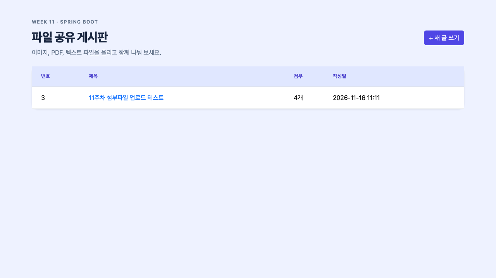
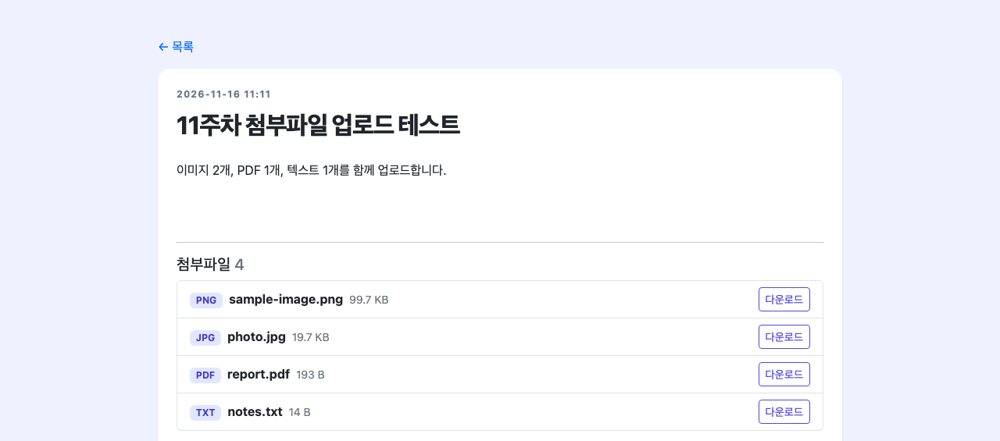
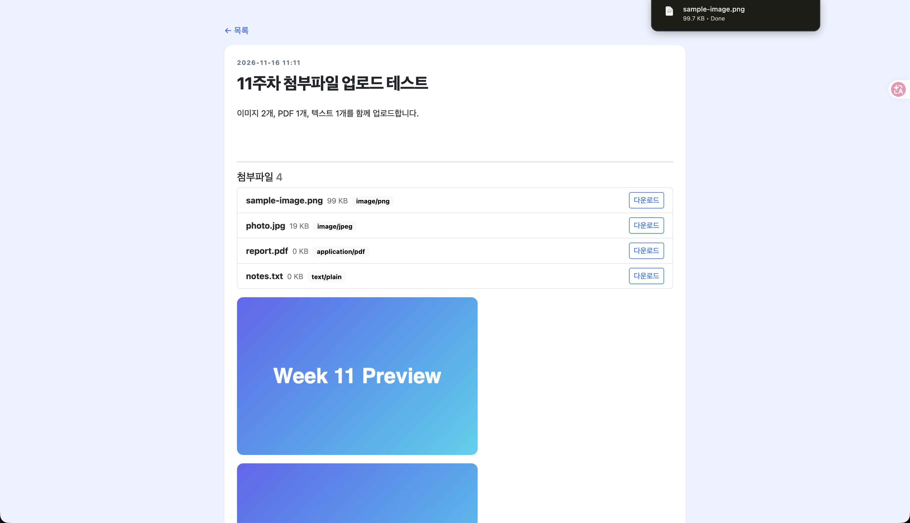
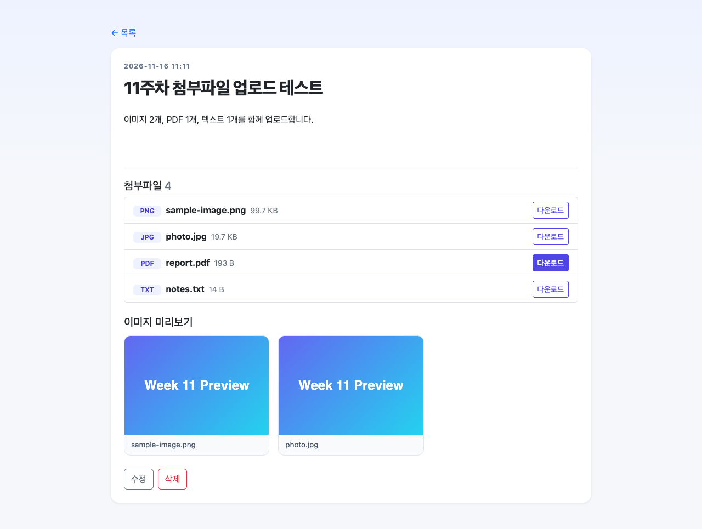

# Week 11 첨부파일 게시판

# Project Information

## 프로젝트 소개
- Spring Boot, Thymeleaf, Spring Data JPA, MariaDB로 만든 첨부파일 게시판입니다.
- 게시글 목록, 작성, 상세, 수정, 삭제 기능을 제공합니다.
- 첨부파일 다운로드와 이미지 미리보기 기능을 제공합니다.
- 허용 형식은 jpg, jpeg, png, gif, pdf, txt이고 파일 하나당 최대 10MB입니다.

## 링크
- GitHub Repository: https://github.com/2026-2-WebService/assign11-c01-22300404
- Render Deployment: https://week11-sample-project-uozl.onrender.com

# Installation

## 필요 환경
- Java 17
- MariaDB
- Gradle Wrapper가 포함되어 있으므로 Gradle을 따로 설치하지 않아도 됩니다.

## 실행 방법
- 프로젝트 폴더에서 ./gradlew bootRun을 실행합니다.
- IntelliJ에서는 AttachmentBoardApplication의 main 메서드를 실행해도 됩니다.
- 실행 후 브라우저에서 http://localhost:8080/posts 에 접속합니다.

# Source Code Exploration

## Project Structure & Spring MVC

### 1. PostController, PostService, PostRepository는 각각 어떤 역할을 하며, 서로 어떻게 연결되는가?
- PostController는 /posts 같은 URL 요청을 받아 PostService를 호출하고, 결과를 Model에 담아 list.html, form.html, detail.html 화면을 반환합니다.
- PostService는 all(), get(), create(), update(), delete()에서 @Transactional로 실제 처리를 하고, 파일 저장은 FileStorageService에 맡깁니다.
- PostRepository는 JpaRepository를 상속해 SQL을 직접 쓰지 않고 posts 테이블을 조회하고 저장합니다.
- 세 클래스는 생성자 주입으로 연결되어 PostController가 PostService를, PostService가 PostRepository를 사용합니다.

### 2. 게시글 작성 시 HTML Form의 입력값과 첨부파일은 Controller에 어떻게 전달되는가?
- form.html의 form은 method가 post이고 enctype이 multipart/form-data라서 글자 입력값과 파일을 한 요청으로 보냅니다.
- 제목과 내용은 th:field로 묶여 PostController.create()의 @ModelAttribute PostForm에 담기고, @Valid로 비어 있는지 검사됩니다.
- name이 files인 file input의 파일들은 @RequestParam(name = "files") List of MultipartFile로 전달됩니다.

## JPA & Entity Relationship

### 3. Post와 Attachment Entity는 어떤 관계이며, @ManyToOne과 @OneToMany는 각각 어떤 역할을 하는가?
- 게시글 하나에 첨부파일 여러 개가 달리는 1:N 관계입니다.
- Attachment.post의 @ManyToOne과 @JoinColumn(name = "post_id")는 attachments 테이블에 post_id 외래키를 만들고 관계를 관리하는 쪽입니다.
- Post.attachments의 @OneToMany(mappedBy = "post")는 외래키를 갖지 않고, 게시글에 달린 첨부파일 목록을 읽기 위한 쪽입니다.
- Post.addAttachment()가 목록에 추가하면서 Attachment의 post도 설정해 양쪽 관계를 맞춥니다.

### 4. cascade = CascadeType.ALL과 orphanRemoval = true는 어떤 역할을 하며, 실제 디스크에 저장된 파일에도 영향을 주는가?
- cascade = CascadeType.ALL은 Post를 저장하거나 삭제할 때 연결된 Attachment도 함께 저장하거나 삭제하게 합니다. 그래서 PostService.create()는 saveAndFlush(post) 한 번으로 첨부파일 정보까지 저장합니다.
- orphanRemoval = true는 Post의 attachments 목록에서 빠진 Attachment를 DB에서도 삭제합니다.
- 두 설정은 DB의 attachments 행에만 적용되고 uploads 폴더의 실제 파일은 지우지 않습니다. 그래서 PostService.delete()가 FileStorageService.deleteIfExists()로 파일을 먼저 직접 삭제합니다.

## File Upload

### 5. MultipartFile은 무엇이며, 업로드된 파일은 어떤 과정을 거쳐 서버에 저장되는가?
- MultipartFile은 multipart 요청으로 올라온 파일 하나를 나타내는 Spring 인터페이스로, 원래 이름, 크기, 내용 스트림을 꺼낼 수 있습니다.
- PostService.create()가 파일마다 FileStorageService.store()를 호출하고, store()는 빈 파일, 이름, 확장자, 10MB 크기를 검사한 뒤 UUID 이름과 저장 경로를 만듭니다.
- getInputStream()으로 읽은 내용을 Files.copy()로 uploads 폴더에 쓰고, 파일 정보를 담은 Attachment를 돌려줍니다.
- PostService.create()는 이 Attachment를 Post에 붙여 DB에 저장하고, 중간에 실패하면 이미 저장한 파일을 지웁니다.

### 6. 파일을 원본 이름 대신 UUID 기반 파일명으로 저장하는 이유는 무엇인가?
- 여러 사용자가 같은 이름의 파일을 올려도 서로 덮어쓰지 않게 하기 위해서입니다.
- 사용자가 정한 이름을 서버 경로에 그대로 쓰지 않으므로 특수문자나 경로 조작 문제를 피할 수 있습니다.
- FileStorageService.store()가 UUID.randomUUID()에 확장자를 붙여 저장 이름을 만들고, 원래 이름은 Attachment.originalFilename에 따로 저장해 다운로드할 때 사용합니다.

## File Download & Security

### 7. 파일 다운로드 시 Resource, ResponseEntity, Content-Disposition은 각각 어떤 역할을 하는가?
- Resource는 디스크의 실제 파일을 가리키는 객체로, FileStorageService.load()가 PathResource로 만들어 돌려줍니다.
- ResponseEntity는 상태 코드, 헤더, 본문을 포함한 HTTP 응답 전체이고, AttachmentController.download()는 200 상태와 application/octet-stream 형식으로 Resource를 본문에 담아 보냅니다.
- Content-Disposition 헤더는 attachment로 설정되어 브라우저가 파일을 화면에 열지 않고 원래 파일 이름으로 내려받게 합니다.

### 8. 파일 저장 과정에서 normalize()와 startsWith()를 사용하는 이유는 무엇인가?
- normalize()는 경로 안의 .과 ..을 정리해 실제로 가리키는 경로를 만듭니다.
- startsWith(uploadDir)는 정리된 경로가 uploads 폴더 안에 있는지 확인해, ../ 같은 이름으로 다른 폴더의 파일을 쓰거나 읽는 경로 조작 공격을 막습니다.
- FileStorageService.store()에서 저장할 때와 FileStorageService.load()에서 파일을 읽을 때 모두 이 검사를 합니다.

## 주석을 작성한 메서드 3개
- PostController.create(): src/main/java/edu/handong/web11/controller/PostController.java
- FileStorageService.store(): src/main/java/edu/handong/web11/service/FileStorageService.java
- AttachmentController.download(): src/main/java/edu/handong/web11/controller/AttachmentController.java

# Customizing

## 1. 목록 화면 문구 수정
- 파일: src/main/resources/templates/posts/list.html
- 변경 전
    - 제목과 탭 이름: 자료 공유 게시판
    - 작성 버튼: + 게시글 작성
    - 제목 아래 안내 문구 없음
- 변경 후
    - 제목과 탭 이름: 파일 공유 게시판
    - 작성 버튼: + 새 글 쓰기
    - 안내 문구 추가: 이미지, PDF, 텍스트 파일을 올리고 함께 나눠 보세요.

## 2. 색상 스타일 수정
- 파일: src/main/resources/static/css/app.css
- 변경 전
    - 배ㅇ경색 #f5f7fb
    - 버튼은 Bootstrap 기본 파란색
    - 표 머리글 배경 #f8fafc, 글자색 #64748b
- 변경 후
    - 배경색 #eef2ff
    - 버튼 색 인디고 #4f46e5
    - 표 머리글 배경 #e0e7ff, 글자색 #4338ca
    - 안내 문구용 subtitle 스타일 추가

## 3. 첨부파일 형식 표시 추가
- 파일: src/main/resources/templates/posts/detail.html
- 변경 전
    - 첨부파일 목록에 파일 이름과 크기만 표시
- 변경 후
    - 파일 이름과 크기 옆에 image/png, application/pdf 같은 파일 형식 배지를 표시

## 변경 전/후 결과
- 변경 전: 목록 화면, 원래 문구와 원래 색상

- 변경 후: 상세 화면, 바뀐 배경색과 파일 형식 배지

# New Feature

## 이미지 미리보기
- 요청 URL: GET /attachments/{id}/view
- 구현 위치
    - AttachmentController.view()
    - detail.html의 img 태그
    - app.css의 preview-img 스타일

## 요구사항 반영
- 상세 화면 이미지 표시: detail.html이 contentType이 image/로 시작하는 첨부파일(jpg, jpeg, png, gif)만 골라 img 태그로 보여 주고, view()는 Content-Disposition을 inline으로 보내 브라우저가 바로 표시합니다.
- 이미지가 아닌 파일: PDF, TXT는 미리보기를 만들지 않고 기존 다운로드 버튼(GET /attachments/{id}/download)을 그대로 사용합니다.
- 오류 처리
    - 존재하지 않는 첨부파일 ID: 404, 첨부파일이 없습니다.
    - 숫자가 아닌 잘못된 ID: 400
    - 이미지가 아닌 파일을 view로 요청: 400, 이미지 파일만 미리보기할 수 있습니다.
    - DB에는 있지만 실제 파일이 없음: 404, 파일이 없습니다.

# Testing & Deployment

## 테스트 결과
- 01_sample.png: 수정 전 샘플 프로젝트의 빈 게시글 목록

- 02_upload.png: 이미지 2개, PDF 1개, 텍스트 1개를 함께 올린 게시글의 첨부파일 목록

- 03_download.png: 파일 다운로드 성공 화면

- 04_preview.png: 상세 화면에서 이미지 첨부파일 2개가 미리보기로 표시된 화면

## 배포
- Render Deployment URL: https://week11-sample-project-uozl.onrender.com
- Render의 기본 파일 시스템은 재시작이나 재배포 때 초기화될 수 있어서, 배포 환경에서는 이전에 올린 파일이 사라질 수 있습니다.

# Weekly Review

## 새롭게 배운 내용
- multipart/form-data로 파일을 보내면 Spring이 MultipartFile로 받아 주고, 제목과 내용 같은 일반 입력값과 파일을 한 요청에서 함께 처리할 수 있다는 것을 배웠습니다.
- 파일은 디스크에, 파일 정보는 DB에 나누어 저장하고, 저장 이름은 UUID로 만들어 이름 충돌과 경로 조작을 막는 방법을 배웠습니다.
- 같은 파일이라도 Content-Disposition을 attachment로 주면 다운로드되고 inline으로 주면 브라우저에 바로 표시되며, Content-Type이 정확해야 이미지가 제대로 보인다는 것을 배웠습니다.

## 어려웠던 점과 해결 방법
- 처음 빌드할 때 Java 버전이 맞지 않아 빌드가 실패했습니다. build.gradle의 toolchain을 설치된 Java 17에 맞추어 해결했습니다.
- 허용하지 않는 파일을 올리면 500 오류 화면이 나왔습니다. PostController.create()에서 IllegalArgumentException을 잡아 작성 화면에 오류 메시지를 보여 주도록 바꾸었습니다.
- 미리보기를 처음에 복잡하게 구현했다가 이해하기 어려웠습니다. 이미 있던 download() 메서드와 같은 구조로 다시 작성하고 Content-Type과 Content-Disposition만 바꾸어 수업 예제 수준으로 단순하게 만들었습니다.

## AI 활용 내용
- Java 버전 문제로 생긴 빌드 오류 원인 찾기와 해결
- 제출 시, 오류 발견. 
- Render 배포용 Dockerfile 작성

## 느낀 점
- 버전 문제로 빌드에 오류가 생겼었지만, AI를 활용하니 필요한 부분의 수정을 정확하게 할 수 있었습니다. 
- 앞으로 이런 문제에 대해 시간이 단축될 것 같고, ai를 잘 활용하여 개발에 도움이 될 수 있을 것 같다는 생각이 들었습니다. 