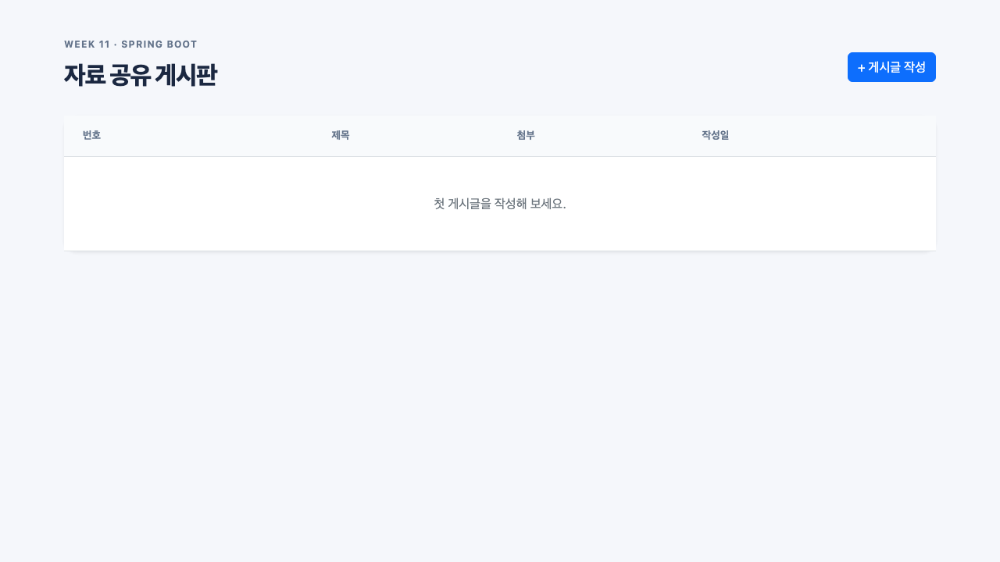

# Week 11 첨부파일 게시판

# Project Information

## 프로젝트 소개
- Spring Boot, Thymeleaf, Spring Data JPA, MariaDB로 만든 첨부파일 게시판입니다.
- 게시글 목록, 작성, 상세, 수정, 삭제 기능을 제공합니다.
- 첨부파일 다운로드와 이미지 미리보기 기능을 제공합니다.
- 허용 형식은 jpg, jpeg, png, gif, pdf, txt이고 파일 하나당 최대 10MB입니다.

## 링크
- GitHub Repository: https://github.com/2026-2-WebService/assign11-c01-22300404
- Render Deployment: https://week11-sample-project-uozl.onrender.com

# Installation

## 필요 환경
- Java 17
- MariaDB
- Gradle Wrapper가 포함되어 있으므로 Gradle을 따로 설치하지 않아도 됩니다.

## 실행 방법
- 프로젝트 폴더에서 ./gradlew bootRun을 실행합니다.
- IntelliJ에서는 AttachmentBoardApplication의 main 메서드를 실행해도 됩니다.
- 실행 후 브라우저에서 http://localhost:8080/posts 에 접속합니다.

# Source Code Exploration

## 1. 게시글과 파일을 함께 올리면 요청은 어떤 순서로 처리되는가
- form.html의 form은 POST 방식이고 enctype이 multipart/form-data입니다.
- PostController.create()가 제목과 내용은 PostForm으로, 파일은 List of MultipartFile로 받습니다.
- PostService.create()가 파일마다 FileStorageService.store()를 호출해 디스크에 저장하고, 만들어진 Attachment를 Post에 붙인 뒤 saveAndFlush로 DB에 저장합니다.
- 저장이 끝나면 /posts/{id} 상세 화면으로 redirect합니다.

## 2. 파일을 원래 이름이 아니라 UUID 이름으로 저장하는 이유는 무엇인가
- FileStorageService.store()에서 UUID.randomUUID()와 확장자를 붙여 저장 이름을 만듭니다.
- 두 사람이 같은 이름의 파일을 올려도 서로 덮어쓰지 않습니다.
- 사용자가 정한 파일 이름이 서버 경로에 그대로 쓰이지 않아 경로 조작 위험이 줄어듭니다.
- 원래 이름은 Attachment.originalFilename에 따로 저장해 다운로드할 때 다시 사용합니다.

## 3. 업로드 파일은 어떤 기준으로 검사하는가
- FileStorageService.store()는 빈 파일, 슬래시나 역슬래시나 ..이 들어간 이름, 240자를 넘는 이름을 거부합니다.
- 확장자가 ALLOWED 목록(jpg, jpeg, png, gif, pdf, txt)에 없으면 거부합니다.
- 파일 크기가 10MB를 넘으면 거부하고, application.properties에도 파일 10MB, 요청 전체 30MB 제한이 있습니다.
- 검사에 실패하면 IllegalArgumentException이 발생하고 PostController.create()가 이를 잡아 작성 화면에 오류 메시지를 보여 줍니다.

## 4. Content-Type은 어떻게 정해지는가
- FileStorageService.store()가 요청 헤더의 Content-Type을 믿지 않고 확장자로 직접 정합니다.
- jpg와 jpeg는 image/jpeg, png는 image/png, gif는 image/gif, pdf는 application/pdf, 나머지는 text/plain입니다.
- 정해진 값은 Attachment.contentType에 저장되고 미리보기 응답의 Content-Type으로 쓰입니다.

## 5. DB에는 무엇이 저장되고 실제 파일은 어디에 저장되는가
- 실제 파일은 app.upload-dir로 지정한 uploads 폴더에 저장됩니다.
- attachments 테이블에는 id, post_id, original_filename, stored_filename, content_type, file_size가 저장됩니다.
- stored_filename에는 unique 제약이 있어 같은 저장 이름이 두 번 들어갈 수 없습니다.
- 관련 파일은 Attachment.java와 application.properties입니다.

## 6. Post와 Attachment는 어떤 관계인가
- Post 하나에 Attachment 여러 개가 연결되는 1:N 관계입니다.
- Post.attachments는 @OneToMany(mappedBy = "post", cascade = ALL, orphanRemoval = true)이고, Attachment.post는 @ManyToOne으로 post_id 외래키를 가집니다.
- Post.addAttachment()가 목록에 추가하면서 Attachment의 post도 함께 설정해 양쪽 관계를 맞춥니다.
- PostRepository는 @EntityGraph로 게시글을 조회할 때 첨부파일을 함께 가져옵니다.

## 7. 다운로드는 어떻게 동작하는가
- 상세 화면의 다운로드 버튼은 GET /attachments/{id}/download로 요청합니다.
- AttachmentController.download()가 id로 Attachment를 찾고, 없으면 404를 반환합니다.
- FileStorageService.load()가 저장 이름으로 실제 파일을 찾아 Resource로 돌려줍니다.
- 응답의 Content-Type은 application/octet-stream이고 Content-Disposition은 attachment와 원래 파일 이름(UTF-8)이라서 브라우저가 파일을 내려받습니다.

## 8. 저장이나 삭제 중 문제가 생기면 파일은 어떻게 정리되는가
- PostService.create()는 이미 저장한 파일을 createdFiles에 모아 두고, 중간에 예외가 나면 그 파일들을 deleteIfExists로 지웁니다.
- FileStorageService.store()는 파일 복사 중 IOException이 나면 만들던 파일을 지우고 500 오류를 던집니다.
- PostService.delete()는 게시글을 지우기 전에 첨부파일을 디스크에서 먼저 삭제하고, DB의 attachments 행은 cascade와 orphanRemoval로 함께 삭제됩니다.

## 주석을 작성한 메서드 3개
- PostController.create(): src/main/java/edu/handong/web11/controller/PostController.java
- FileStorageService.store(): src/main/java/edu/handong/web11/service/FileStorageService.java
- AttachmentController.download(): src/main/java/edu/handong/web11/controller/AttachmentController.java

# Customizing

## 1. 목록 화면 문구 수정
- 파일: src/main/resources/templates/posts/list.html
- 변경 전
    - 제목과 탭 이름: 자료 공유 게시판
    - 작성 버튼: + 게시글 작성
    - 제목 아래 안내 문구 없음
- 변경 후
    - 제목과 탭 이름: 파일 공유 게시판
    - 작성 버튼: + 새 글 쓰기
    - 안내 문구 추가: 이미지, PDF, 텍스트 파일을 올리고 함께 나눠 보세요.

## 2. 색상 스타일 수정
- 파일: src/main/resources/static/css/app.css
- 변경 전
    - 배ㅇ경색 #f5f7fb
    - 버튼은 Bootstrap 기본 파란색
    - 표 머리글 배경 #f8fafc, 글자색 #64748b
- 변경 후
    - 배경색 #eef2ff
    - 버튼 색 인디고 #4f46e5
    - 표 머리글 배경 #e0e7ff, 글자색 #4338ca
    - 안내 문구용 subtitle 스타일 추가

## 3. 첨부파일 형식 표시 추가
- 파일: src/main/resources/templates/posts/detail.html
- 변경 전
    - 첨부파일 목록에 파일 이름과 크기만 표시
- 변경 후
    - 파일 이름과 크기 옆에 image/png, application/pdf 같은 파일 형식 배지를 표시

## 변경 전/후 결과
- 변경 전: 목록 화면, 원래 문구와 원래 색상

- 변경 후: 상세 화면, 바뀐 배경색과 파일 형식 배지

# New Feature

## 이미지 미리보기
- 요청 URL: GET /attachments/{id}/view
- 구현 위치
    - AttachmentController.view()
    - detail.html의 img 태그
    - app.css의 preview-img 스타일

# Testing & Deployment

## 테스트 결과
- 01_sample.png: 수정 전 샘플 프로젝트의 빈 게시글 목록

- 02_upload.png: 이미지 2개, PDF 1개, 텍스트 1개를 함께 올린 게시글의 첨부파일 목록

- 03_download.png: 파일 다운로드 성공 화면

- 04_preview.png: 상세 화면에서 이미지 첨부파일 2개가 미리보기로 표시된 화면

## 배포
- Render Deployment URL: (배포 URL 입력)
- Render의 기본 파일 시스템은 재시작이나 재배포 때 초기화될 수 있어서, 배포 환경에서는 이전에 올린 파일이 사라질 수 있습니다.

# Weekly Review

## 새롭게 배운 내용
- multipart/form-data로 파일을 보내면 Spring이 MultipartFile로 받아 주고, 제목과 내용 같은 일반 입력값과 파일을 한 요청에서 함께 처리할 수 있다는 것을 배웠습니다.
- 파일은 디스크에, 파일 정보는 DB에 나누어 저장하고, 저장 이름은 UUID로 만들어 이름 충돌과 경로 조작을 막는 방법을 배웠습니다.
- 같은 파일이라도 Content-Disposition을 attachment로 주면 다운로드되고 inline으로 주면 브라우저에 바로 표시되며, Content-Type이 정확해야 이미지가 제대로 보인다는 것을 배웠습니다.

## 어려웠던 점과 해결 방법
- 처음 빌드할 때 Java 버전이 맞지 않아 빌드가 실패했습니다. build.gradle의 toolchain을 설치된 Java 17에 맞추어 해결했습니다.
- 허용하지 않는 파일을 올리면 500 오류 화면이 나왔습니다. PostController.create()에서 IllegalArgumentException을 잡아 작성 화면에 오류 메시지를 보여 주도록 바꾸었습니다.
- 미리보기를 처음에 복잡하게 구현했다가 이해하기 어려웠습니다. 이미 있던 download() 메서드와 같은 구조로 다시 작성하고 Content-Type과 Content-Disposition만 바꾸어 수업 예제 수준으로 단순하게 만들었습니다.

## AI 활용 내용
- Java 버전 문제로 생긴 빌드 오류 원인 찾기와 해결
- 제출 시, 오류 발견. 
- Render 배포용 Dockerfile 작성

## 느낀 점
- 버전 문제로 빌드에 오류가 생겼었지만, AI를 활용하니 필요한 부분의 수정을 정확하게 할 수 있었습니다. 
- 앞으로 이런 문제에 대해 시간이 단축될 것 같고, ai를 잘 활용하여 개발에 도움이 될 수 있을 것 같다는 생각이 들었습니다. 